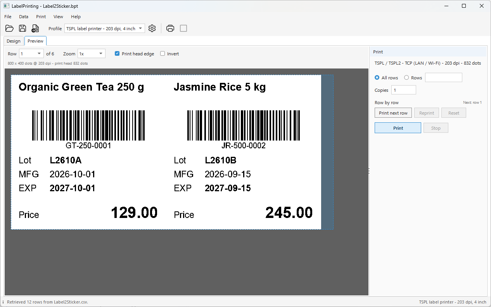
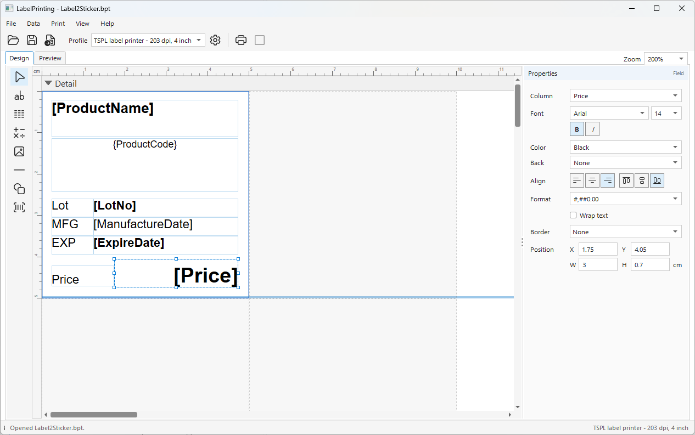

# LabelPrinting

A label printing application in one window: design the label, fill it from a
data file, and print it straight to a label printer - as a 1-bit image wrapped
in the printer's own command language, with no printer driver in between.

<p align="center">
  
</p>

```
dotnet run --project LabelPrinting
```

It needs Windows (WPF, and the USB, spooler and serial port code). In Visual
Studio, open `LabelPrinting.csproj` and press F5.

## What it shows

| Part | How |
| --- | --- |
| Designing the label | `BluePrintDesignerControl` showing its design surface only; the element tools and the Properties panel are the application's own, and change the label through the designer's API |
| The label's data | Retrieve reads a CSV or Excel file through BluePrint's `ExternalImportDialog`; the report holds the columns, not the file |
| The 1-bit image | `MonochromeRenderer` draws each row of labels at the printer's resolution |
| The printer's language | `PrinterCommands.Encode` wraps the image in TSPL, ZPL, EPL or EZPL. This application never writes a printer command itself |
| Getting the bytes there | its own code, in `Transports/`: TCP, USB, the Windows spooler as RAW data, and serial ports |

Everything printer-specific lives in a printer profile. Profiles, and what the
window remembers between runs, are kept in `LabelPrinting.cfg` next to the
executable - a JSON file you can read, copy to another computer, or fix by hand.

## A first label

1. Start the application. It opens `Samples/Label2Sticker.bpt`: a 50 x 50 mm
   product sticker, two across the roll.
2. **Data > Retrieve** (Ctrl+R). The import dialog already points at
   `Label2Sticker.csv` beside the report; press Retrieve. Twelve products fill
   six rows of two labels.
3. **Print > Printer Profiles**, **New from Preset**, pick the preset for your
   printer's language and resolution. On the **Connection** tab choose how the
   printer is connected, and press **Test Connection**.
4. The **Preview** tab (Ctrl+2 - it opens by itself after Retrieve) shows
   exactly what the printer will receive, dot for dot, one row at a time, with
   the print settings beside it. **Print** (Ctrl+P) sends every row;
   **Print next row** (Ctrl+N) sends one row at a time.

No printer at hand? **Save commands...** (Ctrl+Shift+S) writes the bytes that
would be sent to a file instead.

## Designing a label

<p align="center">
  
</p>

The **Design** tab (Ctrl+1) is where the label is drawn.

- **The element tools**, on the left: Select, Text, Field, Compute, Picture,
  Line, Shape and Barcode. Pick one, then click on the label to place it, and
  size it with its handles. Esc goes back to Select. Chart and Sub Band are left out: a black and
  white label has no use for them.
- **The design surface**, in the middle, at 200% so small text is easy to
  place. Undo, copy, paste and delete use the designer's own keys (Ctrl+Z,
  Ctrl+C, Ctrl+V, Del).
- **The Properties panel**, on the right. With nothing selected it shows the
  label itself: its size, how many labels are across the roll, the column gap
  between them and the margins, with the page size they make (one row of
  labels). With elements selected it shows only what a label needs for
  that kind of element - the column of a field, the expression of a compute or
  a barcode, the font, colours, alignment, format, border and position. Select
  several elements to change what they have in common at once.

A value typed into the panel is applied on Enter, or when you leave the field.
One that cannot be used is put back, and the reason is shown at the top of the
panel. Element changes can be undone with Ctrl+Z; the size of the label cannot,
as in the BluePrint designer itself.

## Match the job to the roll in the printer

The label is printed as one image per row of labels, and the printer is told
that size. A label printer finds the start of each label with its gap sensor, so
the roll in the printer has to be the one the report describes:
`Label2Sticker` needs 50 x 50 mm labels, two across a 100 mm wide roll, with a
small gap between rows. Printing it on a roll of a different size can come out
as blank labels, or make the printer stop with a paper error - not a fault in
the data. Set the gap on the **Commands** tab to the gap of your roll.

Before printing on a new roll, run the printer's own label calibration (usually
holding its FEED button), so it measures the label length again.

## Long labels on a narrow printer

`Samples/Label-11x1in-Long.bpt` is a label 279.4 x 25.4 mm (11 x 1 in),
designed the way it is read. It is far wider than a 4 inch print head, so it
goes through the printer sideways: the roll is 25.4 mm wide, and each label is
279.4 mm long.

1. Open the sample and Retrieve: `Label-11x1in-Long.csv` fills twelve rows,
   one label each.
2. In the printer profile, on the **General** tab, set the row to the label as
   it goes through the printer: **Row width** 2.54 cm, **Row height** 27.94 cm.
   **Print width** stays the width of the print head.
3. On the **Image** tab, set **Orientation** to **Landscape**. The
   **Change...** link in the Print panel opens the profile at that tab.
4. The **Preview** tab now shows the image turned: 208 x 2233 dots at 203 dpi,
   inside the print head edge, with `Printed as: Landscape` beside its size.

Landscape turns the label a quarter turn counter-clockwise, as Windows does.
`TOP` and the thick line along the top of the design show which way it came
out; if it comes out the other way round, use **Landscape 180**. The design
itself is never turned: it stays the way the label is read.

A row of several labels across the roll cannot be printed in landscape - the
labels would line up along the roll instead of across it. LabelPrinting says so
in the Print panel and does not print.

### Mirror and Negative

Also on the **Image** tab:

- **Mirror** prints left and right swapped, for a label read through the back
  of clear film.
- **Negative** prints white on black: every dot of the label, but not the
  unused part of the print head. It uses far more ribbon and wears the print
  head faster, so the Print panel says when it is on.

The Preview tab shows the image with both applied - it is exactly what is sent.

### Why there is no ESC/POS

BluePrint can also encode ESC/POS, the language of receipt printers, but this
application leaves it out: ESC/POS has no command to find the gap between
labels, so on a roll of die-cut labels each row lands a little further off.
Every language offered here measures the gap and starts each row on a label.

## Printer profiles

| Tab | What it holds |
| --- | --- |
| General | name, command language, print head resolution and width in cm (rounded to a multiple of 8 dots when you press Enter or leave the box), the size of one row of labels |
| Connection | TCP (host and port, usually 9100), USB (any printer Windows installed as a USB printer - no driver needed), a Windows print queue used as RAW, or a COM port - a paired Bluetooth printer is one |
| Pacing | how the data is sent: in pieces, with pauses |
| Commands | the options of the chosen language, such as the gap, darkness and speed. An empty field leaves the printer's own setting |
| Image | how grey becomes black or white: the threshold, and dithering for pictures. How the image is printed: its orientation, Mirror and Negative |

### Pacing

USB, TCP and the spooler have flow control of their own, so the defaults send
each row in one go (USB in 4 KB pieces, so Stop can act between them). Serial
ports, and Bluetooth printers in particular, often have none: data that does not
fit the printer's buffer is lost without an error. If labels come out cut off,
shifted, or stop half way, lower the chunk size and raise the delay step by
step - for example 512 bytes with 20 ms between chunks.

### The Windows spooler without a driver

The spooler connection sends the commands with the data type RAW: the spooler
passes them to the port unchanged, and the driver draws nothing. The queue still
needs a driver, but any driver that accepts RAW will do, including the
"Generic / Text Only" driver that comes with Windows. A job that is stopped is
deleted from the queue, so half a job never prints.

## Where to look in the code

| File | What it does |
| --- | --- |
| `MainWindow.Retrieve.cs` | the rows: an external data source, read with `ExternalImportDialog` |
| `Printing/RasterPlan.cs` | printer profile to `MonochromeExportOptions` |
| `Printing/CommandSource.cs` | `PrinterCommands.Encode` one row at a time, with exactly the bytes of encoding the whole job at once |
| `Printing/PrintJobRunner.cs` | open, send with pacing, Stop, always close |
| `Transports/` | the four connections and finding devices on this computer |
| `Profiles/AppConfigStore.cs` | `LabelPrinting.cfg`: written through a temporary file; a file that cannot be read is renamed, never overwritten |
| `MainWindow.Printing.cs` | the Print panel of the Preview tab, and the print job |
| `MainWindow.View.cs` | the Design and Preview tabs, their zoom, the panels beside them, and the theme |
| `MainWindow.Tools.cs` | the element tools: buttons that run the designer's own `tool.*` commands |
| `Views/PropertiesPanel.xaml` | the properties of the label or of the selected elements, changed through the designer's `ApplyElementChange` and `ApplyReportChange` so element changes can be undone |
| `Views/PropertyMatrix.cs` | which properties each kind of element shows - the one place that decides it |
| `MainWindow.xaml` (Preview tab) | the 1-bit image of a row: `BluePrintMonochromeView` from `BlueCrafts.BluePrint.Designer` (BluePrint.Render.WPF) shows what `MonochromeRenderer.RenderPage` makes, dot for dot |

## Notes

- The printer profiles are kept next to the executable, so when you run from
  Visual Studio they are in `bin/Debug/net10.0-windows`. Deleting `bin` deletes
  them: copy `LabelPrinting.cfg` somewhere else first.
- Run the application from a folder you can write to; it does not fall back to
  another place for `LabelPrinting.cfg`.
- Print and Export of the designer go through a printer driver, which cannot
  drive a roll of labels; this application leaves them out, together with the
  designer's colour preview. Printing happens in the Print panel only.

## Third-party notices

The toolbar icons (`Views/Icons.xaml`) are paths from
[Fluent UI System Icons](https://github.com/microsoft/fluentui-system-icons)
by Microsoft, used under the MIT License:

```
MIT License

Copyright (c) 2020 Microsoft Corporation

Permission is hereby granted, free of charge, to any person obtaining a copy
of this software and associated documentation files (the "Software"), to deal
in the Software without restriction, including without limitation the rights
to use, copy, modify, merge, publish, distribute, sublicense, and/or sell
copies of the Software, and to permit persons to whom the Software is
furnished to do so, subject to the following conditions:

The above copyright notice and this permission notice shall be included in all
copies or substantial portions of the Software.

THE SOFTWARE IS PROVIDED "AS IS", WITHOUT WARRANTY OF ANY KIND, EXPRESS OR
IMPLIED, INCLUDING BUT NOT LIMITED TO THE WARRANTIES OF MERCHANTABILITY,
FITNESS FOR A PARTICULAR PURPOSE AND NONINFRINGEMENT. IN NO EVENT SHALL THE
AUTHORS OR COPYRIGHT HOLDERS BE LIABLE FOR ANY CLAIM, DAMAGES OR OTHER
LIABILITY, WHETHER IN AN ACTION OF CONTRACT, TORT OR OTHERWISE, ARISING FROM,
OUT OF OR IN CONNECTION WITH THE SOFTWARE OR THE USE OR OTHER DEALINGS IN THE
SOFTWARE.
```
