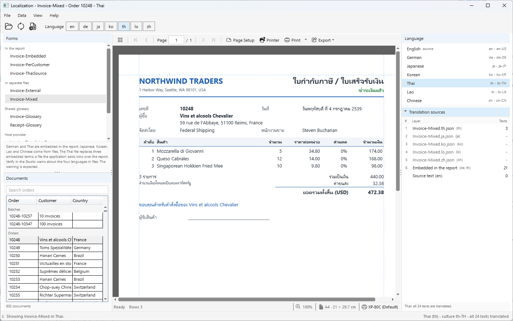
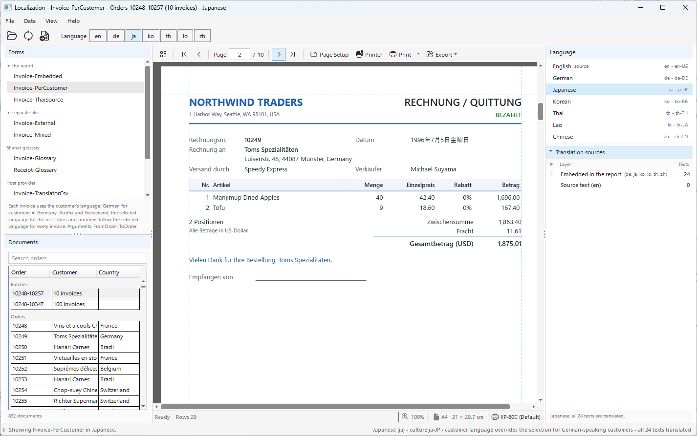

# Localization

One invoice report, printed in seven languages. Pick a form, pick an order of
the Northwind database, and pick a language: the preview shows the invoice with
the texts of that language, the dates and numbers of its culture, and the font
of its script - English, German, Japanese, Korean, Thai, Lao and Chinese.

Every form is the same invoice. What differs is where its translations are
kept: inside the report file, in files next to it, in a glossary shared by two
reports, or in a source of the application. The panel on the right tells which
layer each text of the page comes from.

<p align="center">
  
</p>

```
dotnet run --project Localization
```

It needs Windows (WPF, and the fonts of Windows for Japanese, Korean and
Chinese). In Visual Studio, open `Localization.csproj` and press F5.

## What it shows

| Part | How |
| --- | --- |
| The language of a render | `report.Language = "ja"` - the data is not read again; the same rows are rendered in another language |
| Translations in the report | `localization.items` (texts of elements) and `localization.strings` (named texts for `Tr("key")`) in the `.bpt` file |
| Translations from the application | `report.Translations.AddJson(...)` for a file per language, `report.Translations.Add(source)` for any `IReportStringSource` of your own |
| Dates and numbers | `localization.cultures` gives each language its culture: `Donnerstag, 4. Juli 1996` and `1.234,56` in German, year, month and day in Japanese characters in Japanese |
| Fonts | `localization.fonts` maps the report's font to the font of a script; `keepFont` keeps one element in its own font |
| Where a text comes from | `report.TraceTexts(language)` - the same order the render follows |

## The forms

| Form | Translations | Shows |
| --- | --- | --- |
| `Invoice-Embedded` | in the `.bpt` file, every language | one file, nothing else to deploy |
| `Invoice-External` | `Invoice-External.<language>.json`, one file per language | send a file to a translator without touching the report |
| `Invoice-Mixed` | German and Thai in the report, Japanese, Korean, Lao and Chinese in files, and a Thai file that replaces three embedded terms | a file the application adds wins over the report |
| `Invoice-Glossary` + `Receipt-Glossary` | `Glossary/Glossary.<language>.json`, used by both reports | one glossary for every report of a company; the receipt uses only some of its terms |
| `Invoice-TranslatorCsv` | `Invoice-TranslatorCsv.csv`: the file the Designer exports (**Translations > Export CSV...**) after a translator filled it in | an `IReportStringSource` of the application - a database table or a translation service works the same way |
| `Invoice-PerCustomer` | in the report; each invoice uses `TrIn("key", [CustLang])` | a batch where each invoice is in its customer's language |
| `Invoice-ThaiSource` | in the report; the report is written in Thai (`sourceLanguage: "th"`) | the source language does not have to be English |

Which files a form adds, and in which order, is in `<form>.layers.json` next to
it. The application never guesses the files from the name of a form.

### The order of the layers

Each text is looked up in the layers from the top down, and the first layer that
has it wins: the sources the application added, in the order it added them,
then the translations embedded in the report. A text no layer has shows the
source text. A closer language wins before a more general one: `de-AT` in the
report is used before `de` from a file.

Rendering in the source language looks nothing up. A file for the source
language (`Glossary.en.json`, for example) would never be read, which is why the
glossary has none: the English text is the one written in the report.

To check a report with the layers the application adds, call `doc.Verify()`
after adding them: a language counts as translated when any layer has it. The
showcase's tests do this for every form, and none of them has a warning.

BluePrint Studio reads the translation files named after the report from the
same folder, such as `Invoice-External.de.json` next to `Invoice-External.bpt`,
so **Verify Report** there counts them too. It does not read the glossary or the
CSV file, so for `Invoice-Glossary`, `Receipt-Glossary` and
`Invoice-TranslatorCsv` it warns that the languages in those files are not
translated. That warning is expected.

The shop's name and address print the same in every language. Their labels have
`"translate": false`, so they need no translation and Verify does not count them.

### One batch, a language per customer

<p align="center">
  
</p>

`Invoice-PerCustomer` decides the language of each invoice from the customer:
German for customers in Germany, Austria and Switzerland, the selected language
for the others. Choose **Orders 10248-10257** and Japanese, and the batch mixes
German and Japanese invoices.

The culture belongs to the whole render, though: the German invoices of that
batch show their date and numbers the Japanese way. When each invoice must also
have the dates of its own language, render each language separately.

## Fonts

The forms are written in Leelawadee UI, which has Latin, Thai and Lao. For the
other scripts the report maps it to a font of Windows:

| Language | Font |
| --- | --- |
| Japanese | Yu Gothic UI |
| Korean | Malgun Gothic |
| Chinese | Microsoft YaHei UI |

```json
"fonts": { "ja": [ { "from": "Leelawadee UI", "to": "Yu Gothic UI" } ] }
```

These fonts have the same line height as Leelawadee UI, so no size change is
needed. The company name keeps Leelawadee UI in every language (`"keepFont":
true` on that element). When a font is not installed, a warning above the
preview names it - the text of that language may then show as boxes.

The PDF that **Export** writes embeds the fonts of the language shown, and says
its language (`/Lang`) so that a screen reader reads it right.

## Money

Northwind is in US dollars, so every language shows dollars: the amounts use
`#,##0.00`, which follows the culture, and the total says `(USD)`. The forms do
not use `[currency]`, which would show euros or yen without converting anything.

## Where to look in the code

| File | What it does |
| --- | --- |
| `Forms/FormManifest.cs` | `<form>.layers.json`: the layers of a form, in their order, added with `Translations.AddJson` / `Translations.Add` |
| `Forms/FormLoader.cs` | one form is one `BluePrintDocument`: a new form never keeps the layers of the one before |
| `Translations/CsvStringSource.cs` | an `IReportStringSource` over the CSV the Designer exports |
| `Translations/SourceInspector.cs` | the Translation sources panel, from `report.TraceTexts` |
| `Documents/OrderCatalog.cs` | the orders and batches, with the same SQL as the forms |
| `MainWindow.Preview.cs` | retrieve and show; a new language renders the same rows again; a newer choice cancels a read still running |
| `MainWindow.Fonts.cs` | the warning for a font that is not installed |

## Notes

- The translations of German, Japanese, Korean, Lao and Chinese have not been
  checked by native speakers yet. Corrections are welcome: edit the files in
  `Samples` (or the forms in BluePrint Studio).
- The application remembers the form, order and language of last time in
  `Localization.cfg` next to the executable.
- `northwind.db` is not copied into this folder: the project links the one in
  `../../NorthwindDB/SQLite` and copies it next to the executable when it builds.
- Put your own forms in the `Samples` folder next to the executable
  (**File > Open Samples Folder**), then **File > Refresh Forms**; or open one
  from anywhere with **File > Open Form...**. After you change a translation
  file, **File > Reload Form** (F5) reads it again.

## Third-party notices

The toolbar icons (`Views/Icons.xaml`) are paths from
[Fluent UI System Icons](https://github.com/microsoft/fluentui-system-icons)
by Microsoft, used under the MIT License:

```
MIT License

Copyright (c) 2020 Microsoft Corporation

Permission is hereby granted, free of charge, to any person obtaining a copy
of this software and associated documentation files (the "Software"), to deal
in the Software without restriction, including without limitation the rights
to use, copy, modify, merge, publish, distribute, sublicense, and/or sell
copies of the Software, and to permit persons to whom the Software is
furnished to do so, subject to the following conditions:

The above copyright notice and this permission notice shall be included in all
copies or substantial portions of the Software.

THE SOFTWARE IS PROVIDED "AS IS", WITHOUT WARRANTY OF ANY KIND, EXPRESS OR
IMPLIED, INCLUDING BUT NOT LIMITED TO THE WARRANTIES OF MERCHANTABILITY,
FITNESS FOR A PARTICULAR PURPOSE AND NONINFRINGEMENT. IN NO EVENT SHALL THE
AUTHORS OR COPYRIGHT HOLDERS BE LIABLE FOR ANY CLAIM, DAMAGES OR OTHER
LIABILITY, WHETHER IN AN ACTION OF CONTRACT, TORT OR OTHERWISE, ARISING FROM,
OUT OF OR IN CONNECTION WITH THE SOFTWARE OR THE USE OR OTHER DEALINGS IN THE
SOFTWARE.
```
