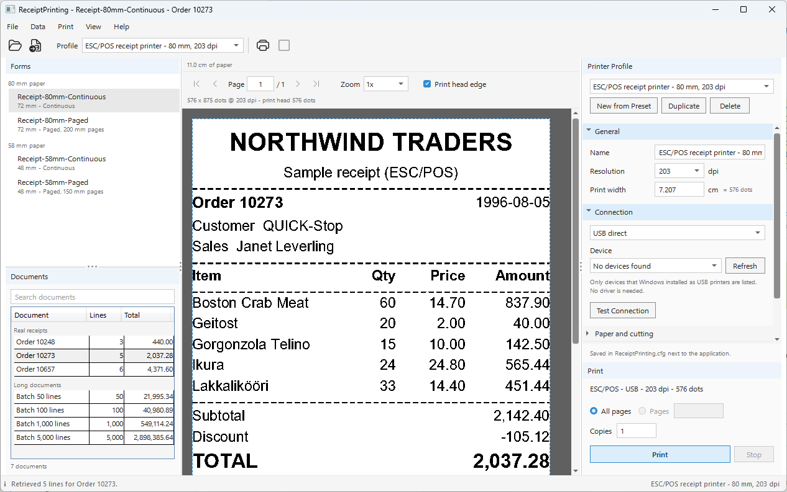
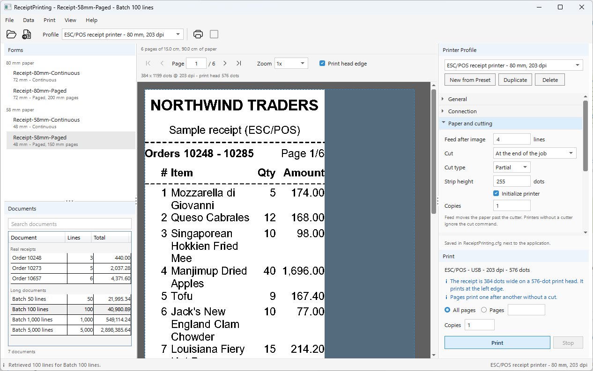

# ReceiptPrinting

A receipt printing application in one window: pick a receipt form, pick a
document, and print it straight to a receipt printer - as a 1-bit image wrapped
in ESC/POS, with no printer driver in between. The data comes from the
Northwind database of this repository, through the forms' own SQL and
retrieval arguments.

<p align="center">
  
</p>

```
dotnet run --project ReceiptPrinting
```

It needs Windows (WPF, and the USB, spooler and serial port code). In Visual
Studio, open `ReceiptPrinting.csproj` and press F5.

## What it shows

| Part | How |
| --- | --- |
| The forms | four ready-made `.bpt` reports in `Samples/`, for 80 mm and 58 mm paper, each one continuous (one long page) and paged. There is nothing to design |
| The data | `BluePrintDocument.RetrieveAsync(connection, arguments)` runs the form's own SQL against `northwind.db` (SQLite) with the document's retrieval arguments |
| The 1-bit image | `MonochromeRenderer` draws the receipt at the printer's resolution; `BluePrintMonochromeView` shows it dot for dot |
| The printer's language | `PrinterCommands.Encode` wraps the image in ESC/POS (`GS v 0`), with the feed, the cut and the cash drawer. This application never writes a printer command itself |
| Getting the bytes there | its own code, in `Transports/`: USB, the Windows spooler as RAW data, TCP, and serial ports |

Everything printer-specific lives in a printer profile, edited in the panel on
the right and saved as soon as a field is committed. Profiles, and what the
window remembers between runs, are kept in `ReceiptPrinting.cfg` next to the
executable - a JSON file you can read, copy to another computer, or fix by hand.

## A first receipt

1. Start the application. It opens `Receipt-80mm-Continuous` with
   `Order 10248`: a receipt of three lines, about 10 cm of paper.
2. On the right, **New from Preset** and pick the preset of your printer:
   80 mm or 58 mm paper, 203 or 180 dpi. Under **Connection** choose how the
   printer is connected - for most receipt printers, **USB direct** and the
   printer from the list - and press **Test Connection**.
3. **Print** (Ctrl+P). The Print panel shows how far the job is, in bytes, and
   the result of the last job.

No printer at hand? **Print > Save Commands...** (Ctrl+Shift+S) writes the
bytes that would be sent to a `.bin` file instead.

## The documents

Each document is a set of retrieval arguments for the forms' SQL:
`@FromOrder`, `@ToOrder` and `@Lines`.

| Document | Orders | Lines |
| --- | --- | --: |
| Order 10248, Order 10273, Order 10657 | one order each | 3, 5, 6 |
| Batch 50 lines | 10248 - 10265 | 50 |
| Batch 100 lines | 10248 - 10285 | 100 |
| Batch 1,000 lines | 10248 - 10625 | 1,000 |
| Batch 5,000 lines | 10248 - 11077, three times | 5,000 |

Northwind has 2,155 order lines in all, so the 5,000-line document goes through
the whole database three times. The long documents are there to see how a
receipt behaves when it gets long, not to look like a real sale.

### Your own database

The forms are ordinary BluePrint reports. To print from your own data, change
the SQL of a form (in BluePrint Studio, or by hand in the `.bpt` file), and in
`MainWindow.Preview.cs` open a connection to your database instead of
`northwind.db`. `RetrieveAsync` takes any open or closed `DbConnection`. The
SQL uses BluePrint's portable functions (`{bp:Limit(@Lines)}`,
`{bp:DateText(...)}`), so the same form runs on SQL Server, PostgreSQL, MySQL,
Oracle, Firebird and SQLite.

## Long receipts

<p align="center">
  
</p>

A continuous form is one page as long as the receipt. BluePrint lays out a
continuous page up to 10 m, and the forms here stay well inside that with
1,000 lines:

| Form | 3 lines | 100 lines | 1,000 lines | 5,000 lines |
| --- | --: | --: | --: | --: |
| 80 mm, continuous | 10.1 cm | 50.9 cm | 4.29 m | longer than 10 m |
| 58 mm, continuous (two lines per item) | 9.9 cm | 81.8 cm | 7.48 m | longer than 10 m |
| 80 mm, paged (pages of 20 cm) | 1 page | 3 pages | 25 pages | 120 pages |
| 58 mm, paged (pages of 15 cm) | 1 page | 6 pages | 47 pages | 235 pages |

For a receipt longer than 10 m the application says so and does not print: use
a paged form. Every page of a paged form is as long as the page, the last one
too, so a short receipt is better on a continuous form.

The strip above the image says how much paper the receipt takes. Before
printing, the Print panel says what is worth knowing: a receipt longer than
5 m, pages or copies that print without a cut between them, and a form that is
narrower or wider than the print head.

### A narrow form on a wide printer

By default the image is as wide as the form at the printer's resolution: a
58 mm form is 384 dots at 203 dpi, and prints at the left edge of an 80 mm
printer (ESC/POS does not centre an image). Under **Image**, **Stretch to the
print head** scales the whole receipt to the head instead - the text then
prints 50% larger than designed. A form wider than the head is cut off at the
right.

## Printer profiles

| Group | What it holds |
| --- | --- |
| General | name, print head resolution, and its width in cm (rounded to a multiple of 8 dots) |
| Connection | USB direct (any printer Windows installed as a USB printer - no driver needed), a Windows print queue used as RAW, TCP (host and port, usually 9100), or a COM port - a paired Bluetooth printer is one |
| Paper and cutting | the lines fed after the receipt so it comes out past the cutter, when to cut (at the end of the job, after every page, or not at all), a partial or a full cut, the height of each `GS v 0` block, and the copies |
| Cash drawer | open the drawer plugged into the printer, once, after the last cut |
| Image | the width of the image, the threshold, and dithering for pictures |
| Pacing | how the data is sent: in pieces, with pauses |

A value is saved when you press Enter, leave the field, pick from a list or
tick a box. A value that cannot be used is not saved: it stays in its box, the
reason is shown under the buttons, and Print waits until it is fixed.

### How long a long receipt takes

`Batch 5,000 lines` on the 80 mm paged form is about 20 m of paper and 12 MB of
commands:

| Connection | Time | |
| --- | --- | --- |
| USB, TCP | the printer sets the pace: about 150 - 250 mm a second, so 1.5 - 2.5 minutes | no pacing needed |
| Serial, 115200 baud | the port sets the pace: about 11.5 KB a second, so about 17 minutes | the Print panel shows the time left |
| Windows spooler | the spooler takes the whole job first, then passes it on | the progress reaches 100% before the paper is out |

Serial ports, and Bluetooth printers in particular, often have no flow control:
data that does not fit the printer's buffer is lost without an error. If
receipts come out cut short, or stop half way, lower the chunk size and raise
the delay step by step - for example 512 bytes with 20 ms between chunks. The
Bluetooth preset starts there.

### The Windows spooler without a driver

The spooler connection sends the commands with the data type RAW: the spooler
passes them to the port unchanged, and the driver draws nothing. The queue still
needs a driver, but any driver that accepts RAW will do, including the
"Generic / Text Only" driver that comes with Windows. A job that is stopped is
deleted from the queue, so half a job never prints.

## Where to look in the code

| File | What it does |
| --- | --- |
| `SampleDocuments.cs` | the documents, and the retrieval arguments each one gives the forms |
| `MainWindow.Preview.cs` | Retrieve, render and the 1-bit image; a newer choice cancels a round still running |
| `Printing/RasterPlan.cs` | printer profile to `MonochromeExportOptions`, for the preview and the printer alike |
| `Printing/RasterChecks.cs` | what the Print panel says before printing |
| `Printing/CommandSource.cs` | `PrinterCommands.Encode` one page at a time, with exactly the bytes of encoding the whole job at once |
| `Printing/PrintJobRunner.cs` | open, send in pieces with pacing, Stop, always close; progress in bytes |
| `Transports/` | the four connections and finding devices on this computer |
| `Profiles/AppConfigStore.cs` | `ReceiptPrinting.cfg`: written through a temporary file; a file that cannot be read is renamed, never overwritten |
| `Views/PrinterProfilePanel.xaml` | the printer profile, checked and saved field by field |
| `MainWindow.Printing.cs` | the Print panel, the print job and Save Commands |

## Notes

- The printer profiles are kept next to the executable, so when you run from
  Visual Studio they are in `bin/Debug/net10.0-windows`. Deleting `bin` deletes
  them: copy `ReceiptPrinting.cfg` somewhere else first.
- Run the application from a folder you can write to; it does not fall back to
  another place for `ReceiptPrinting.cfg`.
- `northwind.db` is not copied into this folder: the project links the one in
  `../../NorthwindDB/SQLite` and copies it next to the executable when it builds.
- Put your own forms in the `Samples` folder next to the executable
  (**File > Open Samples Folder**), then **File > Refresh Forms**; or open one
  from anywhere with **File > Open Form...**.

## Third-party notices

The toolbar icons (`Views/Icons.xaml`) are paths from
[Fluent UI System Icons](https://github.com/microsoft/fluentui-system-icons)
by Microsoft, used under the MIT License:

```
MIT License

Copyright (c) 2020 Microsoft Corporation

Permission is hereby granted, free of charge, to any person obtaining a copy
of this software and associated documentation files (the "Software"), to deal
in the Software without restriction, including without limitation the rights
to use, copy, modify, merge, publish, distribute, sublicense, and/or sell
copies of the Software, and to permit persons to whom the Software is
furnished to do so, subject to the following conditions:

The above copyright notice and this permission notice shall be included in all
copies or substantial portions of the Software.

THE SOFTWARE IS PROVIDED "AS IS", WITHOUT WARRANTY OF ANY KIND, EXPRESS OR
IMPLIED, INCLUDING BUT NOT LIMITED TO THE WARRANTIES OF MERCHANTABILITY,
FITNESS FOR A PARTICULAR PURPOSE AND NONINFRINGEMENT. IN NO EVENT SHALL THE
AUTHORS OR COPYRIGHT HOLDERS BE LIABLE FOR ANY CLAIM, DAMAGES OR OTHER
LIABILITY, WHETHER IN AN ACTION OF CONTRACT, TORT OR OTHERWISE, ARISING FROM,
OUT OF OR IN CONNECTION WITH THE SOFTWARE OR THE USE OR OTHER DEALINGS IN THE
SOFTWARE.
```
