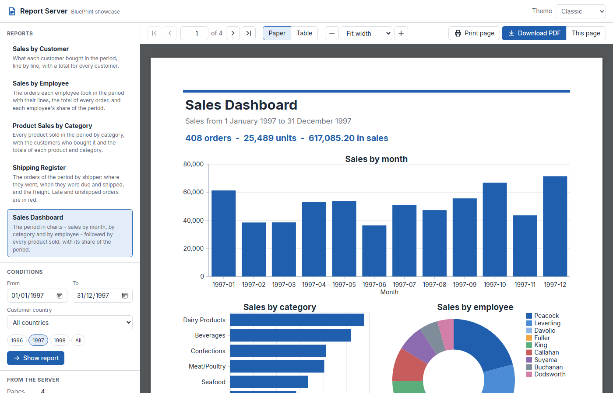
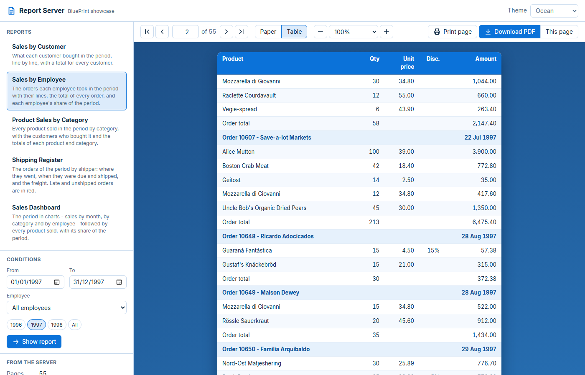
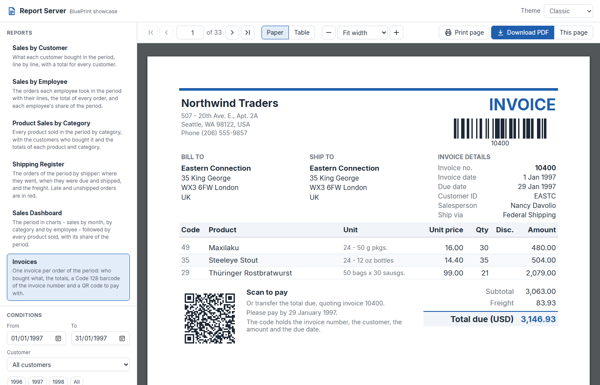

# ReportServer

A report server and the web page that shows its reports.

- **ReportServerAPI** renders six reports of the Northwind database with
  BluePrint - five summaries and a set of invoices with a barcode and a QR
  code - and hands them out **one page at a time** as HTML, or as a PDF.
- **ReportServerWeb** is the web page: choose a report and its conditions, turn
  the pages, change the look with a CSS theme, print the page on the screen, or
  download the PDF.

Both are ASP.NET Core and run the same way on Windows, on Linux and in Docker.
The web page is plain HTML, CSS and JavaScript, with no framework.





## Run it

You need the .NET 10 SDK. Start the API, then the web, each in a terminal of
its own, from this folder:

```
dotnet run --project ReportServerAPI
dotnet run --project ReportServerWeb
```

Open port **5080** of this machine in a browser (`localhost:5080`). The API
listens on port 5081; the web passes every request for `/api` on to it, so the
browser only ever talks to the web.

### In Docker

```
docker compose up --build
```

then open port **8080** of the machine. Only the web is published; it reaches
the API by the name of its service. The images take the Northwind database from
`../../NorthwindDB`, which is why `docker-compose.yml` builds from the top of the
repository.

## What it shows

### One page at a time

```
browser                    ReportServerWeb            ReportServerAPI
  |  /api/reports/x/info  ->  passes it on       ->   render the report once,
  |                                                   keep it in memory
  |  <- 34 pages, page sizes
  |
  |  /api/reports/x/pages/2  ->                  ->   HTML of page 2 only
  |  <- 30 KB
  |
  |  /api/reports/x/pdf      ->                  ->   PDF of the rendered report
```

The server renders the whole report once for a set of conditions - the page
count, the totals of a group that started on an earlier page and the grand
total are only known once every row is laid out - and keeps the result in
memory. Each page then goes to the browser on its own, when it is turned to: a
34-page report is not sent as 34 pages of HTML. The PDF is written from the
same render, so it shows exactly the same pages. The panel on the left tells
how long the render took, whether it came from memory, and how big the page
was.

### Conditions

Every report has a period (From / To, with the years as quick choices) and a
list: a customer country, an employee, a category, a shipper or a customer. They are the
retrieval arguments of the report - the SQL of the report reads them as
`@FromDate`, `@ToDate`, `@Country` - and the API checks every value before it
gets near the database. The lists themselves come from the database.

### Invoices: a barcode and a QR code

*Invoices* prints one invoice per order: the order is the group of the report,
and every group starts on a new page and counts its own pages ("Invoice 10400 -
page 1 of 1"). The head of each invoice carries a **Code 128** barcode of the
invoice number; its foot a **QR code** to pay with, which holds the invoice
number, the customer, the amount due and the due date:

```
INVOICE:10400;CUSTOMER:EASTC;AMOUNT:3146.93;CURRENCY:USD;DUE:1997-01-29
```



Both are barcode elements of the report, filled by an expression - the QR code
adds up the lines with `Sum(Price * Qty * (1 - Disc) for group 1)`, the same
total the invoice prints. In the HTML they are drawn as SVG, so they stay sharp
at any zoom and print cleanly; in the PDF they are part of the page. A year
holds some 400 orders, so this report opens on one month.

### Two layouts and five themes

- **Paper** - every element where the report puts it, with the report's own
  fonts, colours and lines: the page looks like the PDF. A theme changes what
  is around the page - the backdrop, the frame, a colour filter (*Slate* turns
  the page dark, *Sepia* warms it, *Mono* turns it grey).
- **Table** - the same page as a plain `<table>` with no style of BluePrint at
  all; here the theme decides everything: fonts, colours, lines and stripes.

A theme is a file of CSS variables in `ReportServerWeb/wwwroot/themes`. Copy
one, change the values and add it to the list at the top of
`wwwroot/js/app.js`.

### The same text everywhere

The reports use **Inter**, a modern sans-serif made for screens, with Latin,
Greek and Cyrillic (SIL Open Font License, in `ReportServerAPI/fonts` with its
license). Neither Windows nor Linux comes with it, so the server measures and
draws with these files on every platform - the same page on Windows and in a
Linux container, element for element - and the web page gives the browser the
same files, so the HTML shows the text exactly as the server measured it.

### Print and PDF

*Print page* prints the page on the screen, at the paper size of the report.
*Download PDF* gets every page; *This page* only the one on the screen.

## The API

| Request | Answer |
| --- | --- |
| `GET /api/reports` | the reports and their conditions, with the values of the lists |
| `GET /api/reports/{id}/info?<conditions>` | renders (or finds in memory): page count, row count, page sizes |
| `GET /api/reports/{id}/pages/{n}?<conditions>&layout=paper` | the HTML of page n (`layout=table` for the table) |
| `GET /api/reports/{id}/pdf?<conditions>&pages=3` | the PDF; without `pages`, every page |

`<conditions>` are the names of the report's conditions, for example
`FromDate=1997-01-01&ToDate=1997-12-31&Country=USA`; one that is left out takes
its default. An error comes back as `application/problem+json` with a sentence
in `detail`.

## Settings

`ReportServerAPI/appsettings.json`, section `ReportServer`:

| Setting | Default | |
| --- | --- | --- |
| `CacheSize` | 32 | rendered reports kept in memory |
| `CacheMinutes` | 20 | a report nobody asked for this long is dropped |
| `MaxConcurrentRenders` | 4 | renders at the same time; the others wait |
| `RenderTimeoutSeconds` | 120 | a render that takes longer is cancelled |

`ReportServerWeb/appsettings.json`: `ReportServerApi` is where the API is
(`host:port`). Any setting can also be given as an environment variable, for
example `ReportServer__CacheSize=64`.

## Files

```
ReportServerAPI/
  Program.cs                   startup: fonts, the catalog, the endpoints
  Catalog/ReportCatalog.cs     the six reports and their conditions
  Catalog/OptionLists.cs       the values of the lists, from the database
  Catalog/ReportArguments.cs   query string -> checked retrieval arguments
  Rendering/RenderCache.cs     render once, keep in memory
  Rendering/ReportOutput.cs    the HTML of one page, the PDF
  Endpoints/ReportEndpoints.cs the HTTP API
  Reports/*.bpt                the reports
  fonts/                       Inter, its license, fonts.css
ReportServerWeb/
  Program.cs                   the web page, and /api passed on to the API
  wwwroot/index.html
  wwwroot/js/app.js            the viewer
  wwwroot/css/app.css          the page around the report
  wwwroot/css/frame.css        the rules every theme shares
  wwwroot/themes/*.css         the themes
```

## Not in this sample

This is a sample, kept small on purpose. A server open to other people would
add sign-in, a limit on requests, and error messages that say less than these
do (they show the reason as it is, which helps while you try things out).
