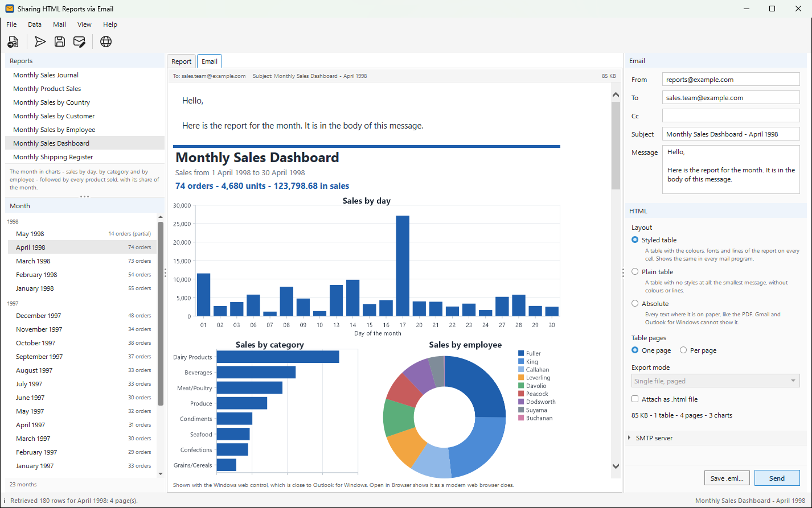
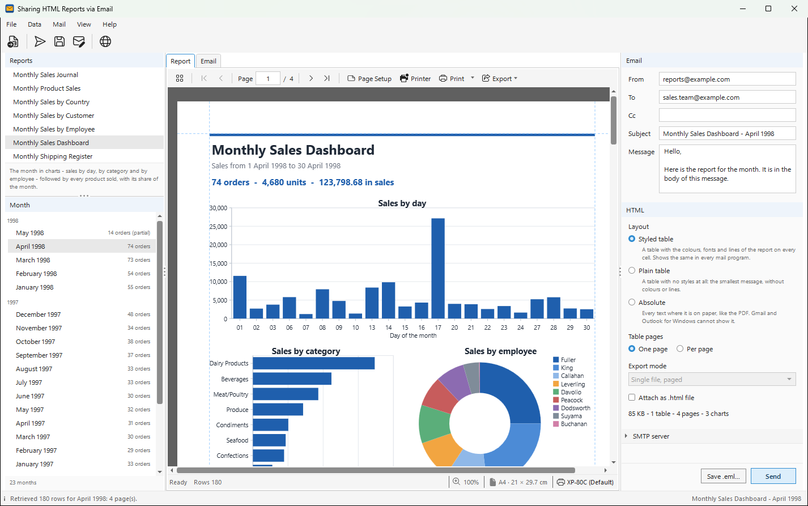

# SharingHTMLReportsViaEmail

Send a monthly report as HTML in the body of an email: pick one of seven monthly
reports of the Northwind database - tables, charts and a crosstab - pick a
month, and send it - the recipient
reads the report right in the inbox, on a phone too, without opening an
attachment.

<p align="center">
  
</p>

```
dotnet run --project SharingHTMLReportsViaEmail
```

It needs Windows (WPF). In Visual Studio, open `SharingHTMLReportsViaEmail.csproj`
and press F5.

## What it shows

| Part | How |
| --- | --- |
| The reports | seven ready-made `.bpt` reports in `Samples/`, each taking the retrieval arguments `FromDate` and `ToDate`. There is nothing to design |
| The data | `BluePrintDocument.RetrieveAsync(connection, arguments)` runs the report's own SQL against `northwind.db` (SQLite) with the first and the last day of the month |
| The preview | `BluePrintPreviewControl`, with its own toolbar: pages, zoom, print, export to PDF or Excel |
| The HTML | `HtmlRenderer.ExportTo(MemoryExportSink, ...)` exports the rendered pages to HTML in memory, with every style written on the element itself (`InlineCss`) - nothing is written to disk |
| The charts | `HtmlExportOptions.ChartFormat = Png` with `EmbedImages = false`: every chart becomes a PNG file, which travels inside the message and which the HTML names with `cid:` |
| The email | `System.Net.Mail` of .NET: a text part and an HTML part with its charts, an optional `.html` attachment, sent through SMTP or saved as an `.eml` file. No mail library is needed |

## A first email, without a mail server

1. Start the application. It opens the **Monthly Sales Journal** for
   **April 1998**: 180 order lines on 7 pages.
2. On the right, type an address in **To** (`someone@example.com` is fine).
3. **Mail > Open in Mail App** (Ctrl+Shift+O). Windows opens the message in
   your mail program; Outlook opens it as a new message, ready to send to a
   real address.

Or **Save .eml...** (Ctrl+S) and open the file with any mail program, or
drag it into one.

## Sending through SMTP

Open **SMTP server** on the right and fill in the server, the port, the
security and, when the server asks for one, the user and the password. Everything
is kept in `SharingHTMLReportsViaEmail.cfg` next to the executable, the password
too, **in plain text**: the file can be copied to another computer with
everything in it, and anyone who can open the folder can read the password.
Keep the folder to yourself, use an app password you can revoke, or leave the
password empty for a relay that does not ask for one.

- **STARTTLS on port 587** is what most providers use. `System.Net.Mail` does
  not support TLS from the first byte (port 465), and it does not support
  OAuth2: for Gmail or Microsoft 365, use an app password, or a relay of your
  organization.
- To try it on this computer, run a local test server such as
  [smtp4dev](https://github.com/rnwood/smtp4dev) or
  [Papercut SMTP](https://github.com/ChangemakerStudios/Papercut-SMTP):
  host `localhost`, port `25`, security **None**, no user.

## Which layout works in which mail program

Mail programs are not web browsers. Gmail and Outlook for Windows remove style
sheets (`<style>`), and they do not support CSS positioning at all. The right
panel has three layouts to compare; the **Email** tab shows the message as it
is sent, and **Open in Browser** (Ctrl+B) shows it in your web browser.

| Layout | `HtmlExportOptions` | Gmail, Outlook for Windows | Apple Mail, Thunderbird, browsers | Size of April 1998, Monthly Sales Journal |
| --- | --- | --- | --- | --: |
| **Styled table** (default) | `TableLayout` + `InlineCss` | the report with its colours, fonts and lines | the same | about 280 KB |
| **Plain table** | `TableLayout` | a table without colours or lines | the same | about 50 KB |
| **Absolute** | `Absolute` + `InlineCss` | the layout is lost | like the PDF | about 480 KB |

For a table, **Table pages** chooses between **One page** - one table for the
whole month, with the column headings and the page number once - and
**Per page**, one table for every printed page. For the absolute layout,
**Export mode** chooses between one long page (**Single file**) and the
printed pages one under the other (**Single file, paged**).

**Gmail shows only the first 102 KB of a message** and puts the rest behind
"View entire message". A month of these reports is bigger than that with
styles on every cell; the right panel says so before you send. Plain table
stays under it, and **Attach as .html file** adds the full report, laid out
like the PDF, for opening in a browser.

## The reports

| Report | Groups | Rows of April 1998 | Pages |
| --- | --- | --: | --: |
| Monthly Sales Journal | day | 180 order lines | 7 |
| Monthly Sales by Customer | customer | 180 order lines | 9 |
| Monthly Product Sales | category, product | 180 order lines | 10 |
| Monthly Sales by Employee | employee, order | 180 order lines | 11 |
| Monthly Shipping Register | shipper | 74 orders, late and unshipped ones in red | 3 |
| Monthly Sales Dashboard | three charts - sales by day, by category, by employee - then category, product | 180 order lines | 4 |
| Monthly Sales by Country | a crosstab on landscape paper: country and customer down, the eight categories across | 180 order lines | 4 |

Each one takes the arguments `@FromDate` and `@ToDate`, and its SQL uses the
portable functions of BluePrint (`{bp:DateText(...)}`, `{bp:Name(...)}`), so
it runs on the other databases BluePrint supports as well. Put a report of your
own that takes the same two arguments in the `Samples` folder next to the
executable (**File > Open Samples Folder**), then **File > Refresh Reports**.

<p align="center">
  
</p>

## Where to look in the code

| File | What it does |
| --- | --- |
| `Reports/MonthCatalog.cs` | the months with orders, and the `FromDate` / `ToDate` of a month |
| `Reports/ReportCatalog.cs` | the reports in `Samples/`, and whether they take the two arguments |
| `MainWindow.Preview.cs` | Retrieve and render; a newer choice cancels a round still running |
| `Mail/HtmlEmailBuilder.cs` | the three layouts as `HtmlExportOptions`, the export to memory, the charts as `cid:` pictures, the message above the report, the size and the notes |
| `Mail/MailComposer.cs` | the `MailMessage`: addresses, subject, text and HTML parts, the charts as linked resources, attachment |
| `Mail/MailSender.cs` | SMTP, `.eml` files and Open in Mail App |
| `MainWindow.Email.cs` | the right panel and the Email tab; options change the message without reading the database again |
| `AppConfig.cs` | `SharingHTMLReportsViaEmail.cfg` next to the executable, the SMTP password included (plain text) |

## Notes

- The settings are kept next to the executable, so when you run from Visual
  Studio they are in `bin/Debug/net10.0-windows`.
- `northwind.db` is not copied into this folder: the project links the one in
  `../../NorthwindDB/SQLite` and copies it next to the executable when it builds.
- The **Email** tab uses the web control of Windows, which shows HTML much like
  Outlook for Windows does. Use **Open in Browser** to see it as a modern browser does.
- Charts are sent as pictures attached to the message and named by `cid:`.
  The other ways HTML can carry a chart do not survive the trip: Gmail and
  Outlook for Windows show no inline SVG, and no picture written into the HTML
  itself (`data:`). In the **Email** tab and **Open in Browser**, which cannot
  read `cid:`, the same pictures are written to a folder next to the page.
- Gmail's 102 KB counts the HTML only; the pictures of the charts come on top
  of it and do not make the message clip.

## Third-party notices

The toolbar icons (`Views/Icons.xaml`) are paths from
[Fluent UI System Icons](https://github.com/microsoft/fluentui-system-icons)
by Microsoft, used under the MIT License:

```
MIT License

Copyright (c) 2020 Microsoft Corporation

Permission is hereby granted, free of charge, to any person obtaining a copy
of this software and associated documentation files (the "Software"), to deal
in the Software without restriction, including without limitation the rights
to use, copy, modify, merge, publish, distribute, sublicense, and/or sell
copies of the Software, and to permit persons to whom the Software is
furnished to do so, subject to the following conditions:

The above copyright notice and this permission notice shall be included in all
copies or substantial portions of the Software.

THE SOFTWARE IS PROVIDED "AS IS", WITHOUT WARRANTY OF ANY KIND, EXPRESS OR
IMPLIED, INCLUDING BUT NOT LIMITED TO THE WARRANTIES OF MERCHANTABILITY,
FITNESS FOR A PARTICULAR PURPOSE AND NONINFRINGEMENT. IN NO EVENT SHALL THE
AUTHORS OR COPYRIGHT HOLDERS BE LIABLE FOR ANY CLAIM, DAMAGES OR OTHER
LIABILITY, WHETHER IN AN ACTION OF CONTRACT, TORT OR OTHERWISE, ARISING FROM,
OUT OF OR IN CONNECTION WITH THE SOFTWARE OR THE USE OR OTHER DEALINGS IN THE
SOFTWARE.
```
